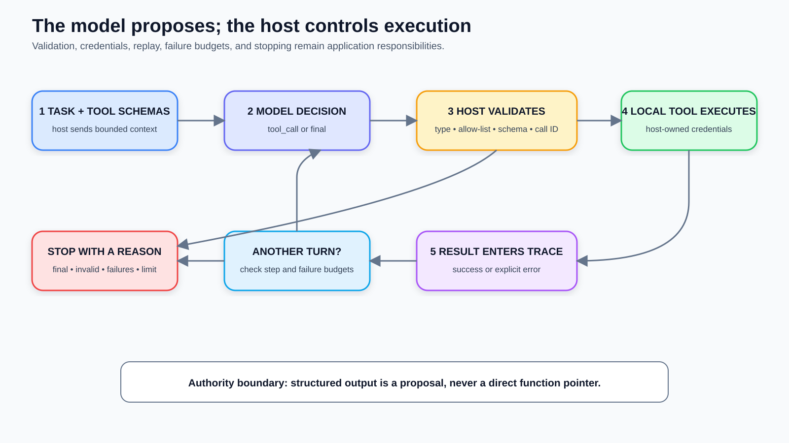

# Building a Minimal Tool-Using Agent

*Part 3 of Agentic AI Engineering: give a model useful tools without giving it direct execution authority.*

**Series navigation:** Previous: Part 2 — The Six Configuration Surfaces of an Agent | Course index: Agentic AI Engineering | Next: Part 4 — Inside the Reasoning Loop

*Disclosure: This draft was developed with AI assistance. The named author is
responsible for checking the code, technical claims, visual, and final publication.*

A familiar review comment appears in early agent code: “The model calls this
function.” That sentence is convenient, but it hides the most important
engineering boundary in the system. The model does not hold your function
pointer, database credential, or process permissions. It produces a proposal.
Your application decides whether the proposal is well formed, allowed, safe to
repeat, and worth another turn.

That distinction is the whole lesson. In this article, you will build a small
release-analysis agent with three local tools. The model side is replaced by a
deterministic script, so you can inspect and test the host loop without an
external service or secret. The result is deliberately modest: one task, a
closed tool registry, schema validation, structured results, replay protection,
and explicit stop budgets. Those pieces are enough to expose where authority
actually lives.

## Reading Path

If tool calling is new to you, read from **Before You Start** through the success
trace in order. If you have used a framework, begin with **The Model Proposes;
the Host Authorizes**, inspect the dispatcher and failure paths, then compare the
implementation with the abstraction you already use. The exercise extends the
same loop with a fourth read-only tool; the retrieval questions test whether you
can reason about the boundary without looking at the code.

## Learning Outcomes

By the end of this lesson, you will be able to:

1. Trace the five transitions that turn a model decision into an observed tool result.
2. Implement a closed tool registry and validate arguments before dispatch.
3. Test malformed calls, duplicate identifiers, unknown tools, and execution budgets without a live model.
4. Explain which decisions belong to the model and which controls must remain with the host application.

## Before You Start

Part 1 gave us a bounded definition of an agent: a system in which a model can
choose actions inside a controlled loop. Part 2 turned that boundary into six
configuration surfaces. Its tool surface allowed three read-only operations:
`read_release_notes`, `read_test_summary`, and `request_clarification`. It denied
release promotion and limited the run by step and failure counts.

This lesson makes that configuration executable. You should be comfortable
reading Python functions and dictionary-shaped data. The example uses JavaScript
Object Notation (JSON) Schema Draft 2020-12 through the `jsonschema` Python
package. You do not need a model account or application programming interface
(API) key.

Before reading further, answer one question: if a model returns the string
`"delete_release"`, which component has the power to turn that string into a real
operation? If your answer is “the model,” look for the line in your application
that performs dispatch. That line—not the generated text—is where authority
crosses the boundary.

## Mental Model

A minimal tool-using agent is a protocol loop with five transitions:

1. The host sends the task, available tool descriptions, and relevant trace to a model adapter.
2. The adapter normalizes the model response into either `tool_call` or `final`.
3. The host validates the decision, tool name, arguments, and call identifier.
4. The host executes an allow-listed handler and converts success or failure into a structured result.
5. The host appends that result to the trace, checks its budgets, and either asks for another decision or stops.

The model chooses *what it wants to try*. The host controls *what can happen*.
Keeping those verbs separate prevents a useful interface from becoming an
accidental permissions system.



**Figure 1: The model proposes the next move; the host controls whether and how it executes.**

The diagram also shows why “valid structured output” is only one checkpoint. A
syntactically correct object can still name an unknown tool, omit a required
argument, reuse an identifier for a different operation, exceed a run budget, or
request an action the current identity cannot perform. Format is not authority.

## The Model Proposes; the Host Authorizes

Current tool-use interfaces differ in field names, message roles, and whether a
provider executes some tools on its own infrastructure. The durable architectural
shape is simpler. A client-defined tool has a name, description, argument schema,
and handler. The model sees the first three. The application owns the fourth.

Anthropic's client-tool documentation makes this round trip explicit: the model
returns a structured `tool_use` block, the application runs the client tool, and
the application sends a `tool_result` back for the next turn. OpenAI's current
function-calling guidance likewise describes connecting models to external
functions and distinguishes valid JSON from adherence to a particular schema.
The provider formats are not identical, but both leave application code with an
execution boundary to implement.

Our example keeps that boundary behind a tiny protocol:

```python
class ModelAdapter(Protocol):
    def decide(
        self,
        task: str,
        trace: list[dict[str, Any]],
    ) -> dict[str, Any]: ...
```

A production adapter would translate a provider response into one of two local
forms:

```json
{
  "type": "tool_call",
  "call_id": "call-17",
  "name": "read_test_summary",
  "arguments": {"release_id": "2.5"}
}
```

or:

```json
{
  "type": "final",
  "text": "Release 2.5 has no failing tests."
}
```

Normalizing at the edge has two benefits. The core loop does not depend on one
provider's message classes, and its tests do not depend on a stochastic model.
You can test parsing in the adapter, policy in the host, and tool behavior in the
handler as separate units.

Do not interpret “provider-neutral” as “every provider behaves the same.” Some
interfaces support parallel calls, server-executed tools, streaming arguments,
or restricted schema subsets. An adapter must preserve the provider's documented
semantics. The local decision type only prevents those differences from leaking
through every line of your dispatcher.

## A Tool Is a Contract, Not Just a Callable

The example represents each tool with a small immutable record:

```python
@dataclass(frozen=True)
class Tool:
    name: str
    description: str
    input_schema: dict[str, Any]
    handler: ToolHandler
    read_only: bool = True
```

The name and description help the model choose. The input schema constrains the
proposal. The handler implements the actual operation. `read_only` is metadata
for policy review; in a larger system, the host would use it when deciding
whether approval is required.

Here is the shared schema for the two release-reading tools:

```python
RELEASE_ID_SCHEMA = {
    "$schema": "https://json-schema.org/draft/2020-12/schema",
    "type": "object",
    "additionalProperties": False,
    "required": ["release_id"],
    "properties": {
        "release_id": {
            "type": "string",
            "pattern": r"^[0-9]+\.[0-9]+$",
        }
    },
}
```

Every word in that schema does work. `type: object` prevents an array or scalar
from being treated as keyword arguments. `required` makes absence an error.
`additionalProperties: false` rejects a misspelling such as `release` instead of
`release_id`. The pattern narrows the exercise's accepted identifier format.

JSON Schema validates structure. It cannot decide whether release 2.5 belongs to
the current project, whether the caller may read it, or whether the returned
record contains sensitive data. Those checks belong in the handler, surrounding
service, credential layer, or result policy. Treat schema validation as one
layer, not a safety certificate.

The registry is closed and explicit:

```python
def default_tools() -> list[Tool]:
    return [
        Tool(
            "read_release_notes",
            "Read notes for one release.",
            RELEASE_ID_SCHEMA,
            read_release_notes,
        ),
        Tool(
            "read_test_summary",
            "Read test counts for one release.",
            RELEASE_ID_SCHEMA,
            read_test_summary,
        ),
        Tool(
            "request_clarification",
            "Ask the user for missing task context.",
            QUESTION_SCHEMA,
            request_clarification,
        ),
    ]
```

This is intentionally less clever than dynamic lookup. Avoid code that resolves
an arbitrary model-provided string against module globals, imports a matching
name, or passes it to a shell. A dictionary built from reviewed `Tool` objects
makes the action space inspectable. If `delete_release` is absent, that proposal
becomes an `unknown_tool` result. It never becomes a search for something
executable.

## Worked Example

### Review Release 2.5

The task is “Review release 2.5.” The local data contains two release notes and
a test summary with 148 passed, zero failed, and two skipped tests. A scripted
adapter produces three decisions: read the notes, read the test summary, and
then return a final sentence.

The script is not pretending to be intelligent. It is a fixture that makes the
host behavior exact. Once the host loop is trustworthy, a provider adapter can
replace the script without changing the registry or dispatcher tests.

The loop begins with a task event and owns two counters:

```python
def run(self, task: str, model: ModelAdapter) -> dict[str, Any]:
    trace = [{"type": "task", "text": task}]
    completed_calls = {}
    failures = 0

    for step in range(1, self._policy.max_steps + 1):
        decision = model.decide(task, list(trace))
        trace.append({"type": "model_decision", "step": step, **decision})
        # Validate, dispatch, record, and stop below.
```

Passing `list(trace)` gives the adapter a shallow copy of the event list. It is
not a security boundary—nested values remain shared—but it prevents an adapter
from casually appending to the host's trace. A production trace store would use
immutable event records or serialize at the boundary.

When the decision is a final answer, the host checks that it contains non-empty
text and returns a completed result. When it is a tool call, `_execute` checks
the call identifier, name, argument object, replay state, registry, and schema
before calling the handler.

The important line is ordinary Python:

```python
tool = self._tools.get(name)
if tool is None:
    return unknown_tool_result(call)

errors = sorted(
    Draft202012Validator(tool.input_schema).iter_errors(arguments),
    key=lambda error: list(error.path),
)
if errors:
    return invalid_argument_result(call, errors[0].message)

output = tool.handler(**arguments)
```

The model did not call `tool.handler`. It supplied data that survived several
host-owned checks. Only then did the application perform the call using its own
process identity and permissions.

Run the successful fixture:

```bash
.venv/bin/python medium/examples/agentic-ai-engineering/part-03/tool_loop.py success
```

The full output includes the task and every decision. Its compact shape is:

```text
task
  model_decision: read_release_notes(release_id="2.5")
  tool_result: ok, two notes
  model_decision: read_test_summary(release_id="2.5")
  tool_result: ok, passed=148, failed=0, skipped=2
  model_decision: final
completed after 3 steps
```

The exact final answer is:

```text
Release 2.5 has two documented changes; 148 tests passed, 0 failed, and 2 were skipped.
```

This trace proves a narrow fact: given these scripted decisions and in-memory
fixtures, the host invoked the expected two handlers and returned their recorded
values. It does not prove that a live model will choose those tools, that the
release is safe, or that skipped tests are acceptable. Those are separate
behavioral and domain decisions.

## Why Results Must Re-enter the Trace

A tool result is not merely a return value used by local code. It is an
observation for the next model decision. The host records the result with the
matching call identifier, tool name, success flag, output or error, and replay
status. A provider adapter can translate this event back into the provider's
expected message form.

The identifier binds proposal and observation. Without it, parallel or repeated
calls can be attached to the wrong request. Even in a sequential loop, the ID is
valuable audit evidence: it lets a reviewer connect the proposed arguments to
the handler outcome.

Repeated identifiers need a documented policy. The example treats an identical
call ID plus identical name and arguments as a replay. It returns the stored
result without running the handler again. If the same ID arrives with different
content, it returns `call_id_collision`.

That choice matters even for read-only tools. Reads can be expensive, rate
limited, or time-dependent. For a mutating tool, accidental re-execution can
create duplicate tickets, charges, messages, or deployments. Real systems often
persist idempotency records outside process memory so a restart does not erase
them. Our dictionary is sufficient only for one in-process teaching run.

## Failure Is an Observation, Not an Exception Leak

Now run the invalid fixture:

```bash
.venv/bin/python medium/examples/agentic-ai-engineering/part-03/tool_loop.py invalid
```

The scripted model sends this well-formed JSON object:

```json
{
  "type": "tool_call",
  "call_id": "call-1",
  "name": "read_test_summary",
  "arguments": {"release": "2.5"}
}
```

It parses correctly, but it violates the tool schema. The host records:

```json
{
  "type": "tool_result",
  "call_id": "call-1",
  "name": "read_test_summary",
  "ok": false,
  "error": {
    "code": "invalid_arguments",
    "message": "Additional properties are not allowed ('release' was unexpected)"
  },
  "replayed": false
}
```

The script repeats the same call ID. The loop returns the same error with
`replayed: true` and does not repeat validation or handler execution. The third
decision reports that the summary could not be verified.

Converting failures into bounded data is useful because the next decision can
correct an argument, ask for clarification, choose another tool, or stop honestly.
Do not send raw stack traces, credentials, database queries, or internal paths
back to the model. A production error adapter should expose a stable code and a
sanitized message while preserving detailed diagnostics in protected logs.

The Model Context Protocol (MCP) tool specification makes the wider boundary
visible. Its guidance assigns input validation, access control, rate limiting,
output sanitization, sensitive-operation confirmation, result validation,
timeouts, and audit logging to clients and servers. A tool schema contributes to
that design, but it does not implement the rest.

## Two Budgets Prevent an Endless Conversation

The loop has `max_steps` and `max_tool_failures`. A step counts each model
decision, including a final response. A tool failure counts an invalid decision,
unknown tool, schema rejection, call-ID collision, or handler exception. The run
stops when failures exceed the configured allowance or when no step remains.

Why use two budgets? A model can produce valid, successful calls forever, so a
failure counter alone cannot bound cost or latency. Conversely, one malformed
call inside a generous step budget should not necessarily consume the entire
run. The counters answer different questions:

- `max_steps`: how much iterative work may this task consume?
- `max_tool_failures`: how much unsuccessful execution may occur before the host stops retrying?

The implementation uses `failures > max_tool_failures`. With a value of two, the
first two failures are tolerated and the third stops the run. If your policy
intends “stop on the second failure,” use `>=` or define the field as
`allowed_failures: 1`. Boundary names and tests must agree; off-by-one ambiguity
is a policy defect, not a cosmetic detail.

Stopping should return a reason such as `step_budget_exhausted` or
`tool_failure_budget_exhausted`. Do not manufacture a successful final answer
when the loop simply ran out of permission to continue. The caller needs to know
whether the task completed, paused for a user, or stopped under policy.

## Tested Environment

The companion example was verified on 2026-09-05 with:

- Python 3.12.13 on macOS;
- `jsonschema` 4.26.0;
- no network request, model provider, or API key;
- an Ubuntu continuous-integration contract using `requirements.txt`.

Run the focused suite:

```bash
.venv/bin/python -m unittest discover \
  -s medium/examples/agentic-ai-engineering/part-03 -v
```

Expected summary:

```text
Ran 6 tests

OK
```

The six tests verify:

1. two successful tool calls followed by a final answer;
2. malformed arguments become visible error data;
3. an identical repeated call ID replays without handler re-execution;
4. the same call ID with different content is rejected;
5. an unknown tool exhausts a zero-tolerance failure budget;
6. repeated valid calls stop at the step limit.

The test suite deliberately does not call a live model. That separation makes
host behavior reproducible, but it also defines the limit of the evidence. Add
provider-adapter contract tests for message translation, behavioral evaluations
for tool choice, permission tests for deployed identities, and integration tests
for real tool services before treating this as production-ready.

## What to Keep When You Add a Framework

Frameworks can remove repetitive serialization, tracing, and provider-adapter
code. They do not remove the need to answer four ownership questions:

1. Where is the final allow-list enforced?
2. Where are arguments validated against the schema you reviewed?
3. What prevents or safely replays a duplicated call?
4. Which event proves why the loop stopped?

If you cannot locate those controls, write a black-box test that forces each
failure. The goal is not to avoid frameworks. It is to know whether the framework
owns a policy, exposes a hook for your application to own it, or silently chooses
a default.

Anthropic's engineering guidance recommends beginning with simple, composable
patterns and understanding the underlying code when a framework abstracts model
and tool interactions. The article now carries a note that the tooling landscape
has changed since its December 2024 publication, which is another reason to keep
your core contract testable apart from a specific helper API.

## Exercise

### Add a Risk-Register Tool

Extend the local release analyst with one more read-only tool:

```python
def read_risk_register(release_id: str) -> dict[str, Any]:
    ...
```

Use the same release-ID schema. Add a risk fixture for release 2.5 with two open
items: cache rollback verification and audit-field compatibility. Register the
tool with a narrow description. Then change the scripted success path so it
reads notes, tests, and risks before producing the final answer.

Your independent task has four parts:

1. Add `risks` to the in-memory release record.
2. Implement and register `read_risk_register`.
3. Insert a third tool call with a new call ID before the final decision.
4. Add one successful test and one invalid-argument test for the new tool.

Do not alter the dispatcher. If adding a read-only tool requires a new `if name
== ...` branch inside `_execute`, the registry is not yet doing its job.

### Expected Output

The completed run should have four model decisions and three successful tool
results. A compact trace should read:

```text
read_release_notes -> ok
read_test_summary -> ok
read_risk_register -> ok, open=2
final -> Release 2.5 has 2 open risks; tests have 0 failures and 2 skips.
```

Your test summary should grow from six to eight tests:

```text
Ran 8 tests

OK
```

## Check Your Work

Confirm each statement before moving on:

- The model-visible name exactly matches the registry key.
- The handler accepts only `release_id`; an extra or misspelled field fails.
- The new scripted call uses a unique call ID.
- The trace contains the arguments and returned risk count.
- Repeating that call ID does not execute the handler twice.
- The final answer reports open risks without claiming the release is safe.
- No model credential, network request, or dynamic function lookup was added.

If the successful path works but the malformed argument reaches the handler,
inspect where validation occurs. If the third call runs twice during replay,
inspect when the completed result is stored. If the loop reaches a fifth model
decision, inspect whether the final response is counted as a step.

## Retrieval Practice

Answer these without reopening the implementation:

1. What are the five transitions in the tool-call loop?
2. Why does valid JSON not prove that tool arguments match the tool contract?
3. What is the difference between an identical call replay and a call-ID collision?
4. Why are both a step budget and a failure budget useful?

Transfer prompt: apply the same boundary to a payment assistant. Which checks
must occur between a proposed `issue_refund` call and the real payment handler?
Name the schema checks, authorization evidence, approval rule, idempotency key,
audit event, and stop condition. Then decide whether the tool should be exposed
at all for the first release.

## Project Milestone

Your course repository can now contain a minimal local agent harness:

- a provider adapter boundary that returns normalized decisions;
- a closed registry of three or more narrow tools;
- argument schemas validated before dispatch;
- structured success and failure results;
- replay protection keyed by call ID;
- explicit step and failure budgets;
- a deterministic suite that runs without a live model.

Keep the trace format. Part 4 will add richer state transitions, and later
lessons will use the same events for retries, retrieval provenance, evaluations,
and release gates.

## Recap

A tool-using agent is not a model with direct access to functions. It is a host
application running a controlled protocol loop around model proposals. The host
defines the registry, validates arguments, executes with application credentials,
records observations, handles replays, counts failures, and stops visibly.

The durable mental model is short: **propose, validate, execute, observe, repeat
or stop**. If those verbs are collapsed into “the model called a tool,” review
the code until you can identify the owner of each transition.

## Next Lesson

Part 4, **Inside the Reasoning Loop**, will replace the simple scripted sequence
with explicit loop state. We will compare react-style interleaving with a
plan-execute shape, trace one task through state transitions, and decide what
reasoning information belongs in operational state rather than hidden prose.

**Series navigation:** Previous: Part 2 — The Six Configuration Surfaces of an Agent | Course index: Agentic AI Engineering | Next: Part 4 — Inside the Reasoning Loop

## Sources

- [Anthropic documentation: Tool use with Claude](https://platform.claude.com/docs/en/agents-and-tools/tool-use/overview)
- [OpenAI Help Center: Function Calling in the OpenAI API](https://help.openai.com/en/articles/8555517-function-calling-in-the-openai-api)
- [Model Context Protocol specification: Tools, revision 2025-06-18](https://modelcontextprotocol.io/specification/2025-06-18/server/tools)
- [JSON Schema documentation: Object Validation](https://json-schema.org/understanding-json-schema/reference/object)
- [jsonschema 4.26.0 documentation: Schema Validation](https://python-jsonschema.readthedocs.io/en/stable/validate/)
- [Anthropic engineering: Building Effective Agents](https://www.anthropic.com/engineering/building-effective-agents)
- [Runnable Part 3 example and tests](../../examples/agentic-ai-engineering/part-03/README.md)

*Correction note: If a technical error is found, update the canonical Markdown,
the matching tests and claim register, the Notion mirror, and the package hashes
before changing any platform copy.*
